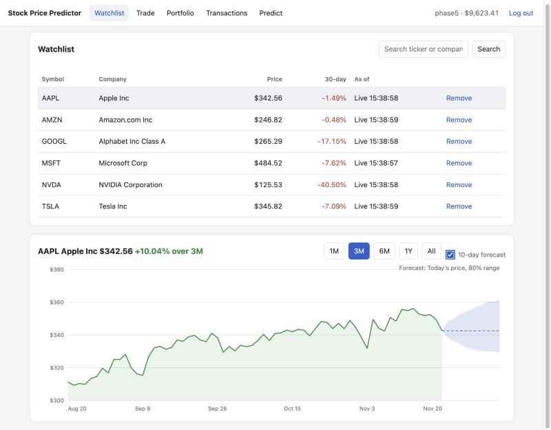

# Stock Price Predictor

[](https://github.com/mahajanp2804/Stock-Price-Predictor/actions/workflows/ci.yml)

A Java app for **paper trading** and **short-term price forecasting**, as a **web app** (Spring Boot + browser UI) and a **desktop app** (Swing), sharing one core. Log in, start with a virtual $10,000, buy and sell real stocks at live market prices, track profit and loss, and see forecasts that have been tested against what actually happened.



> **Disclaimer:** This is an educational project. Forecasts come from simple statistical indicators. They are not financial advice.

## Features

- **Any US stock or ETF:** each user has their own watchlist (up to 20). Search by ticker or company name to add one; new accounts start with AAPL, MSFT, AMZN, GOOGL and TSLA.
- **Price charts:** select a stock to see its daily closes over 1M, 3M, 6M, 1Y or all history, with the price under the mouse and an optional 10-day forecast range.
- **Live prices:** Finnhub quotes refresh every minute and again right before each trade. About 14 months of daily price history comes from Twelve Data (falling back to Alpha Vantage) and is cached in MySQL, so restarts don't re-download it and the app still works when providers are down. Downloads are paced to Twelve Data's free limit of 8 a minute, so a first start with a long watchlist can take a minute or two.
- **Accounts:** register and log in. Passwords are hashed with standard bcrypt (cost 12).
- **Paper trading:** buy and sell against a virtual balance. Money is exact (`DECIMAL` / `BigDecimal`), and each trade locks the user's balance inside one database transaction, so simultaneous trades can't overspend.
- **Responsive UI:** all database and network work runs in the background.
- **Portfolio:** holdings with average cost, market value and unrealised P&L, plus cash, total value, total return, realised P&L and a chart of portfolio value over time.
- **Limit and stop orders:** buy below a price, take profit above one, or set a stop-loss. Open orders are checked against every quote refresh and fill at the market price once triggered; each fill runs in one database transaction, so an order can't fill twice.
- **Transaction history** with realised P&L on every sell, and CSV export of the portfolio and of transactions.
- **Honest price prediction:** before forecasting, every model is backtested on the stock's own history and compared with simply assuming the price stays the same. The most accurate one is used, and each forecast comes with an 80% range based on that model's real past errors.
- **Trend analysis:** 5-day vs 20-day moving-average crossover (Strong Uptrend … Strong Downtrend).
- **Two front ends, one core:** a browser UI backed by a REST API, and a Swing desktop app. Both use the same database, trading rules and models.
- **Light and dark themes:** the web UI follows the system setting; the desktop app has a toggle (FlatLaf).

## Tech stack

Java 17 · Spring Boot 4 · Swing + FlatLaf · MySQL 8 + HikariCP + Flyway · bcrypt (at.favre.lib) · SLF4J · JUnit 5 · Maven (multi-module) · Docker Compose · GitHub Actions

## Getting started

### Prerequisites

- JDK 17 or newer
- Maven 3.9+
- MySQL 8 or newer running locally
- Free API keys: [Twelve Data](https://twelvedata.com) and/or [Alpha Vantage](https://www.alphavantage.co) for price history, and [Finnhub](https://finnhub.io) for live quotes and stock search (optional — without it, trades use the last daily close and you can't add new stocks)

### 1. Configure

```bash
cp config.example.properties config.properties
```

Fill in your API keys and MySQL credentials in `config.properties`. Git ignores this file, and it is never packaged into the jar.

You can set any value as an environment variable instead, and it takes priority over the file. Upper-case the key and replace `.` with `_`:

| Property | Environment variable |
|---|---|
| `finnhub.key` | `FINNHUB_KEY` |
| `twelvedata.key` | `TWELVEDATA_KEY` |
| `alphavantage.key` | `ALPHAVANTAGE_KEY` |
| `db.url` / `db.user` / `db.password` | `DB_URL` / `DB_USER` / `DB_PASSWORD` |

### 2. Build and run

```bash
mvn clean package
```

**Web app** — then open http://localhost:8080:

```bash
java -jar web/target/stock-trading-web.jar
```

**Desktop app:**

```bash
java -jar desktop/target/stock-trading-app.jar
```

Run either from the project root so it finds `config.properties`. The web app's port can be changed with the `PORT` environment variable.

### Or: run the web app with Docker

Needs only Docker — no Java, Maven or MySQL install:

```bash
cp .env.example .env    # set the two passwords and your API keys
docker compose up --build
```

Then open http://localhost:8080. MySQL runs in its own container with its data in a named volume; `docker compose down -v` removes everything.

**The database sets itself up.** With the default `db.url` (`…/stockdb?createDatabaseIfNotExist=true`), MySQL creates `stockdb` and [Flyway](https://flywaydb.org) applies the schema migrations in `core/src/main/resources/db/migration` on first connect.

**Upgrading from an older version:** a `stockdb` created by the old `stockdb.sql` script is detected and upgraded automatically, and your data is kept. Accounts created with the old password hashing still log in and are moved to standard bcrypt on their next login.

### Run tests

```bash
mvn test
```

The database tests (`*DbTest`) run only when `TEST_DB_URL` points at a MySQL server; otherwise they're skipped. They empty every table they touch, so use a separate database, never your real one:

```bash
TEST_DB_URL='jdbc:mysql://127.0.0.1:3306/stockdb_test?createDatabaseIfNotExist=true' TEST_DB_USER=root TEST_DB_PASSWORD=yourpassword mvn test
```

CI runs all tests, including the database and web API tests, against MySQL 8.4 on every push, then builds the Docker image and smoke-tests the running app.

## Project structure

```
├── config.example.properties   # config template (copy to config.properties)
├── pom.xml                     # parent: lists the modules
├── core/                       # shared by the desktop and web apps
│   └── src
│       ├── main/java/com/capstone   # BacktestReport: command-line model comparison
│       │   ├── data/        # history providers (Twelve Data, Alpha Vantage), live quotes and symbol search (Finnhub)
│       │   ├── db/          # connection pool + migrations, config, auth + password hashing, trading, watchlist, price cache
│       │   ├── model/       # Stock, PortfolioEntry, Transaction, Money
│       │   └── prediction/  # forecasting models, walk-forward backtester, indicators
│       ├── main/resources/db/migration/   # Flyway schema migrations (V1, V2, …)
│       └── test/                          # unit tests + database tests (*DbTest)
├── desktop/                    # Swing app → desktop/target/stock-trading-app.jar
│   └── src
│       ├── main/java/com/capstone/ui   # main window, one class per tab, price chart, add-stock search, login, CSV export
│       └── test/                       # UI logic tests
├── web/                        # Spring Boot app → web/target/stock-trading-web.jar
│   └── src
│       ├── main/java/com/capstone/web  # REST controllers, bearer-token sessions, security headers
│       ├── main/resources/static/      # browser UI (HTML, CSS, JS — no build step)
│       └── test/                       # API tests over HTTP against a real database
├── Dockerfile                  # builds and runs the web app
└── docker-compose.yml          # web app + MySQL
```

## REST API

All routes return JSON. Except for register, login and health, they need `Authorization: Bearer <token>` from `/api/auth/login`. Errors look like `{"error": "..."}`.

| Method | Path | What it does |
|---|---|---|
| `POST` | `/api/auth/register` | Create an account: `{"username", "password"}` |
| `POST` | `/api/auth/login` | Returns `{"token", "username"}` (token valid 12 hours) |
| `POST` | `/api/auth/logout` | Ends the session |
| `GET` | `/api/health` | `200` when the database is reachable |
| `GET` | `/api/me` | Username and cash balance |
| `GET` | `/api/watchlist` | Your stocks with latest price, 30-day change and quote time |
| `POST` | `/api/watchlist` | Add a stock: `{"symbol", "name"}` |
| `DELETE` | `/api/watchlist/{symbol}` | Remove a stock (refused while you hold shares) |
| `GET` | `/api/search?q=` | Find US stocks and ETFs by ticker or name |
| `GET` | `/api/stocks/{symbol}/history?period=3M` | Daily closes: `1M`, `3M`, `6M`, `1Y` or `ALL` |
| `GET` | `/api/stocks/{symbol}/forecast?days=5` | Backtest scores for each model, the most accurate one, and its forecast with 80% ranges (`&model=` to pick one) |
| `POST` | `/api/trades` | `{"symbol", "side": "BUY" or "SELL", "quantity"}`, executed at a fresh quote; `422` if refused |
| `GET` | `/api/portfolio` | Holdings with market value and unrealised P&L |
| `GET` | `/api/portfolio/report` | Cash, holdings, total return, realised and unrealised P&L, and daily value since the first trade |
| `GET` | `/api/transactions` | Trade history, newest first, with `realizedPnL` on sells |
| `GET` | `/api/orders` | Your open orders, then the 50 most recently closed |
| `POST` | `/api/orders` | `{"symbol", "side": "BUY" or "SELL", "type": "LIMIT" or "STOP", "quantity", "triggerPrice"}`; checked against the current price straight away |
| `DELETE` | `/api/orders/{id}` | Cancel one of your open orders |

**Order types:** a limit buy fills when the price falls to or below the trigger, a limit sell when it rises to or above it; a stop buy fills when the price rises to the trigger, a stop sell (stop-loss) when it falls to it. A stock with shares held or open orders can't be removed from the watchlist.

Stock routes only serve symbols on your own watchlist, so the shared API allowance can't be spent on arbitrary tickers.

## How the prediction works

The app compares three ways of forecasting a stock's closing price N trading days ahead:

| Model | What it predicts |
|---|---|
| **Today's price** | No change: every future day equals the latest close. This is the standard baseline for stock prices. |
| **Average drift** | The average daily change of the last 30 closes continues. |
| **Regression + EMA + RSI** | The app's original model: a least-squares line through the last 30 closes, nudged toward the 14-day EMA and damped when RSI says overbought (> 70) or oversold (< 30). |

### Walk-forward backtest

For every past day in the history, each model forecasts using **only the prices known on that day**. The forecast is then compared with what actually happened. With about 300 days of history, that's roughly 270 scored forecasts per stock. For each model the app reports:

- **Average error:** in dollars and as a percent of the price.
- **Up/down right:** how often it called the direction correctly. 50% is a coin flip.
- **80% range:** the 10th to 90th percentile of its past errors for each day ahead.

The Predict Prices tab runs this backtest for the selected stock, forecasts with the most accurate model (or one you pick), and shows the range.

### Results

Data from 2025-09-15 to 2026-11-20. Each cell is the average error as a percent of the price, then how often the model called up or down correctly. Bold marks the most accurate model.

| Stock | 1 day: Today's price | 1 day: Average drift | 1 day: Regression + EMA + RSI | 5 days: Today's price | 5 days: Average drift | 5 days: Regression + EMA + RSI |
|---|---|---|---|---|---|---|
| Apple | **1.10%** | 1.12%, 47% | 2.44%, 50% | **2.64%** | 2.88%, 43% | 3.85%, 41% |
| Microsoft | **1.45%** | 1.49%, 52% | 3.08%, 50% | **3.47%** | 3.88%, 48% | 5.11%, 49% |
| Amazon | **1.58%** | 1.63%, 46% | 3.26%, 50% | **3.71%** | 4.37%, 39% | 5.43%, 46% |
| Google | **1.50%** | 1.55%, 50% | 3.25%, 50% | **3.71%** | 4.17%, 52% | 4.99%, 52% |
| Tesla | **2.23%** | 2.29%, 47% | 3.79%, 54% | **4.73%** | 5.27%, 47% | 5.92%, 55% |

What this shows:

- **No model beat "today's price"** for any stock, one day or five days ahead. That's expected: daily stock prices behave close to a random walk, so simple patterns in past prices don't predict them.
- **The original Regression + EMA + RSI model is about twice as wrong as "today's price" one day ahead.** Its forecast isn't anchored to the latest price: it snaps back toward the 30-day trend line and the lagging EMA. On a steady uptrend, the RSI "overbought" damping pulls it down further (there's a unit test documenting this).
- **Up/down calls land between 39% and 55%**, about a coin flip.
- The useful output is the **80% range**: a realistic idea of how far the price might move. For example, in 80% of past cases, Apple's price five trading days later was between 3.2% below and 3.7% above where it started.

To reproduce these tables with the latest data:

```bash
mvn clean package -DskipTests
java -cp desktop/target/stock-trading-app.jar com.capstone.BacktestReport 1 5
```

### Trend label

The Predict Trend tab compares the 5-day and 20-day simple moving averages (Strong Uptrend … Strong Downtrend). It describes recent movement; it isn't a forecast.

## Roadmap

- [x] Keep secrets out of git; allow environment-variable config
- [x] Standard Maven layout, runnable jar, CI
- [x] Exact money arithmetic, locked balance updates, responsive UI, live price refresh, standard bcrypt, SLF4J logging
- [x] Database tests in CI, Flyway migrations, GUI split into one class per tab
- [x] 14 months of cached price history, walk-forward backtest against a "price stays the same" baseline, forecast ranges
- [x] Stocks identified by ticker, per-user watchlist, search for any US stock or ETF, price charts
- [x] Core / desktop / web modules, REST API, browser UI, Docker Compose, CI smoke test of the container
- [x] Portfolio value over time, realised P&L, total return, limit and stop orders
- [ ] Public deployment with a demo link
